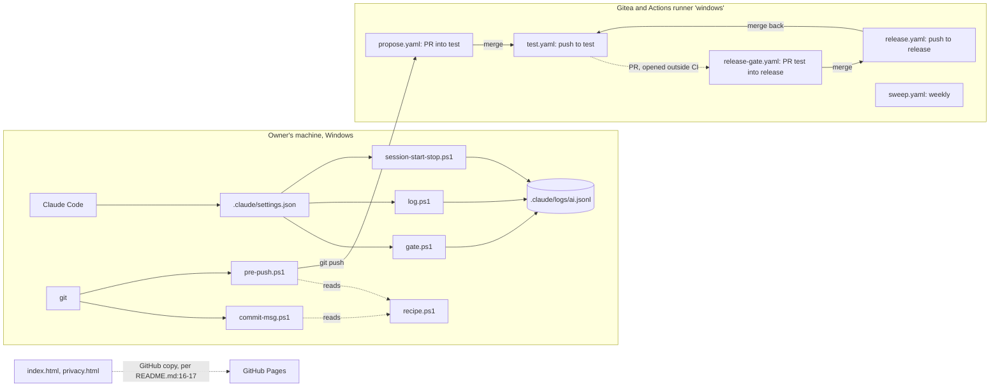

# ai-claude-code - documentation hub

This repository holds the public home page (`index.html`) and the privacy
policy (`privacy.html`) of the Google OAuth application of "AI Claude Code", a
personal assistant that one person, the repository owner, runs on his own
computer to create and read entries in his own Google Tasks and Google Calendar
(`README.md:3-7`, `index.html:18-22`). The assistant program itself is not in
this repository: "This repository ships no program" (`README.md:23`). Besides
the two pages, the repository carries the owner's lab tooling: a `recipe.ps1`
command interface, Claude Code hooks, git hooks and five Gitea Actions
workflows.

The requirements reverse-engineered from the code are in [SPEC.md](../SPEC.md).

Source references are `path:line` relative to the repository root; short names
stand for files in `.claude/hooks/` (`gate.ps1`, `log.ps1`,
`session-start-stop.ps1`), `.claude/hooks/git/` (`commit-msg.ps1`,
`pre-push.ps1`) and `.gitea/workflows/` (`propose.yaml`, `test.yaml`,
`release-gate.yaml`, `release.yaml`, `sweep.yaml`).

## Status

| Item | Fact | Source |
|---|---|---|
| Last commit | `571945c`, 2026-11-07 15:22:58 +0200, merge of PR #18 from `test` into `release` | `git log -1` |
| History | 14 commits; the first, `3d30744` (2026-10-22), added the two pages; the other 13 (2026-11-07) added the README, licence, `CLAUDE.md` and the tooling | `git log` |
| Version | `$Version = '1.0.0'`; tag `v1.0.0` points at `571945c` | `recipe.ps1:11`, `git tag -l` |
| Automated tests | None. `pytest --collect-only` over `.claude` collects 0 tests; `recipe.ps1 test` accepts pytest exit code 5 | `.claude/pytest.ini:2`, `recipe.ps1:47-48` |
| CI | Five workflows under `.gitea/workflows/` for Gitea Actions on a runner labelled `windows`. There is no `.github/workflows/` | `.gitea/workflows/*.yaml` |
| TODO / FIXME | 0 occurrences in tracked files | grep over the checkout |
| Declared exceptions | The README states compliance with lab requirements revision 4.0.0 except R-02, R-09, R-37, R-41, R-42, tracked as issues #7-#11 | `README.md:34` |

What is evidently unfinished or inactive:

- The workflows contain steps for an installer, a wiki (`tools/wiki.py`) and
  manual tests (`tests/manual/tests.json`, `tests/manual/serve.py`). None of
  those files exist; the steps are skipped for this repository because
  `recipe.ps1` names no `$App` and an empty `$Provides`, and because there is no
  manual test list (`test.yaml:46-53`, `test.yaml:73-74`,
  `release-gate.yaml:111`, `release-gate.yaml:139-149`).
- R-37, R-41 and R-42 are listed as exceptions without an explanation in the
  repository (`README.md:34`; R-02 and R-09 are explained in `CLAUDE.md:63-67`).

## Layout

| Path | What it is |
|---|---|
| `index.html` | Home page of the OAuth application; static HTML, inline CSS, an English text and a Russian paragraph |
| `privacy.html` | Privacy policy: what is accessed, use, storage, sharing, Google API policy, revocation, contact |
| `README.md` | Project description (English) |
| `CLAUDE.md` | The repository's rules for work done with Claude Code (branches, commits, keys, logs, gate, releases) |
| `LICENSE` | MIT licence |
| `recipe.ps1` | Command interface (`build`, `install`, `uninstall`, `clean`, `run`, `publish`, `info`, `test`) and the metadata the hooks and workflows read |
| `.claude/settings.json` | Claude Code hook registration and three environment variables |
| `.claude/hooks/gate.ps1` | PreToolUse hook for Bash and PowerShell tool calls: denies recursive deletes, force-pushes, history rewrites on `test`/`release` |
| `.claude/hooks/log.ps1` | Appends one JSON line per hook event to `.claude/logs/ai.jsonl` |
| `.claude/hooks/session-start-stop.ps1` | SessionStart / Stop / SessionEnd: log rotation, `core.hooksPath`, branch and issue context |
| `.claude/hooks/git/commit-msg`, `commit-msg.ps1` | Git hook: commit subject grammar, Signed-off-by, no BOM |
| `.claude/hooks/git/pre-push`, `pre-push.ps1` | Git hook: Git LFS hand-off, branch name grammar, override rule for pushes to `release` |
| `.claude/skills/lab-ai-env/SKILL.md` | Claude Code skill: instructions for a report on the hook log and the transcripts |
| `.claude/pytest.ini`, `.claude/ruff.toml` | pytest section (no options) and ruff `required-version` |
| `.gitea/workflows/` | `propose.yaml`, `test.yaml`, `release-gate.yaml`, `release.yaml`, `sweep.yaml` |
| `.gitea/issue_template.md`, `.gitea/pull_request_template.md` | Issue and pull request templates |
| `.gitattributes`, `.gitignore` | Line endings, Git LFS patterns, ignored paths (`.claude/logs/`, `.claude/.env`, caches) |

## Architecture

The repository has three independent parts:

1. **Pages.** Two static HTML files with no script and no dependency
   (`README.md:15-16`). The README states that GitHub Pages serves them from the
   GitHub copy of the repository and that nothing pushes from the Gitea copy to
   GitHub (`README.md:16-19`). The Pages configuration itself is not in the
   repository.
2. **Local tooling on the owner's Windows machine.** Claude Code calls the hooks
   registered in `.claude/settings.json`; each writes to `.claude/logs/ai.jsonl`.
   Git calls `commit-msg` and `pre-push` once `core.hooksPath` is set to
   `.claude/hooks/git` (by `recipe.ps1 test`, `recipe.ps1:42`, or by the
   SessionStart hook, `session-start-stop.ps1:31-36`). The git hooks and the
   workflows read `recipe.ps1` as text with regular expressions; they do not run it
   for its metadata.
3. **Gitea Actions.** Work branches go into `test` through `propose`; `test`
   goes into `release` through `release-gate`; a push to `release` runs
   `release`, which tags, publishes a Gitea release and merges `release` back into
   `test`. `sweep` runs weekly. All of them call the Gitea REST API with the
   `LAB_BOT_TOKEN` secret.



External services named in the files: Gitea (REST API under `/api/v1`, generic
packages under `/api/packages`), GitHub Pages (`README.md:16-17`), Google account
permissions page and Google API Services User Data Policy (links only,
`privacy.html:42-47`).

## Build and run

There is nothing to build or install: "There is no build step, no script and no
dependency" (`README.md:15-16`); `build`, `install`, `uninstall`, `run` and
`publish` print `nothing to <verb>` and exit 0 (`recipe.ps1:69-73`). The pages
are opened as files or through the GitHub Pages address given in `README.md:17`.

Prerequisites for the tooling, as far as the files state them:

| Prerequisite | Version | Source |
|---|---|---|
| Windows PowerShell (`powershell.exe`) | 5.1 ("new PowerShell parses in 5.1") | `.gitea/pull_request_template.md:16`, `.claude/settings.json:8-18` |
| Git for Windows (its `sh.exe` runs the git hooks) | not stated | `.claude/hooks/git/commit-msg:2` |
| Python with pytest | not pinned | `recipe.ps1:46` |
| ruff | `==0.16.1` | `.claude/ruff.toml:2` |
| Git LFS | optional locally; used if `git-lfs` is on PATH | `.claude/hooks/git/pre-push:4-6` |
| Claude Code | not stated | `.claude/settings.json` |

Commands:

| Command | What it does | Source |
|---|---|---|
| `.\recipe.ps1 test` | Sets `core.hooksPath` to `.claude/hooks/git`, runs `python -m pytest .claude` (exit 5 accepted), `python -m ruff check .claude`, `python -m ruff format .claude` (in place) | `README.md:24`, `recipe.ps1:41-55` |
| `& (Join-Path (git rev-parse --show-toplevel) recipe.ps1) test` | The same, from any directory of the checkout; read `$LASTEXITCODE` right after it | `CLAUDE.md:15-19` |
| `.\recipe.ps1 info` | Prints `Name`, `Code`, `Version`, `Summary` | `README.md:24`, `recipe.ps1:56-62` |
| `.\recipe.ps1 clean` | Deletes `__pycache__`, `.pytest_cache`, `.ruff_cache` directories under the root | `recipe.ps1:63-68` |
| `.\recipe.ps1 build` (also `install`, `uninstall`, `run`, `publish`) | Prints `nothing to <verb>` | `recipe.ps1:69-73` |

## Configuration

| Name | Where | Meaning | Default |
|---|---|---|---|
| `.claude/.env` | file, gitignored (`.gitignore:24`) | `KEY=VALUE` lines loaded into the environment by every `recipe.ps1` verb; a variable already set wins; surrounding quotes are trimmed | absent; no key name is read by `recipe.ps1` itself (`recipe.ps1:28-38`) |
| `PYTHONIOENCODING`, `PYTHONUTF8`, `MSYS_NO_PATHCONV` | `.claude/settings.json:2-6` | Environment for Claude Code tool calls | `utf-8`, `1`, `1` |
| `core.hooksPath` | git config | Points git at `.claude/hooks/git` | unset in a fresh clone; set by `recipe.ps1:42` and `session-start-stop.ps1:34` |
| `$Name`, `$Code`, `$Version`, `$Summary` | `recipe.ps1:9-12` | Repository name, project code `acc` (first word of every branch), version, summary | `ai-claude-code`, `acc`, `1.0.0` |
| `$CommitTypes`, `$CommitScopes`, `$BranchTypes` | `recipe.ps1:19-21` | Vocabulary for commit subjects and branch names | see the file |
| `$Reviewers` | `recipe.ps1:22` | Logins allowed to merge into `release` or write the override | one login |
| `$OverridePhrase` | `recipe.ps1:23` | The marker that, on a line of its own with a `Why:` line, records the owner's override | a literal in the file ("a mark, not a password"); not reproduced here |
| `$Needs`, `$Tools`, `$Provides` | `recipe.ps1:13-17` | Dependencies and what is provided to other projects; the `$Needs` and `$Tools` lines are copied into the SBOM (`release.yaml:326`) | empty |
| `required-version` | `.claude/ruff.toml:2` | ruff refuses to run under another version | `==0.16.1` |
| `.claude/settings.local.json` | gitignored (`.gitignore:18`) | Per-person Claude Code settings | absent |
| `LAB_BOT_TOKEN` | Gitea secret | Token for all Gitea API calls in the workflows | not in the repository |
| `WAIT_MINUTES` | `release-gate.yaml:101` | How long `manual-gate` waits for a verdict | `150` |
| `OWNER` | `release-gate.yaml:95`, `release.yaml:21` | Gitea owner of the generic packages for reports | set in the file |

## Usage

**Change a page and release it** (from `CLAUDE.md:8-19`, `CLAUDE.md:42-56`):

1. Open an issue; create a branch `acc-<issue>/<type>/<slug>`, for example
   `acc-7/docs/update-privacy-date` (`CLAUDE.md:8-9`, `pre-push.ps1:41`).
2. Edit `index.html` or `privacy.html`.
3. Run `.\recipe.ps1 test` and read `$LASTEXITCODE`; commit what it leaves.
4. Commit with `git commit -s` and a subject such as
   `docs(docs): update the privacy policy date` (`CLAUDE.md:10`,
   `commit-msg.ps1:40-53`).
5. Push and open a pull request into `test`; `propose / gate` judges the branch
   name, the commit wording and `recipe.ps1 test` (`propose.yaml`).
6. Open a pull request from `test` into `release`; `release-gate` runs.
7. After the merge `release.yaml` publishes `v<Version>` only if that tag does
   not exist yet (`release.yaml:53-56`). With `$Version = '1.0.0'` and tag
   `v1.0.0` present, `$Version` must be raised to publish again.

The README states that a change in the Gitea copy does not reach the GitHub
Pages address by itself (`README.md:17-19`).

**Print the metadata** (output observed on 2026-11-18):

```
PS> .\recipe.ps1 info
Name    : ai-claude-code
Code    : acc
Version : 1.0.0
Summary : The home page and privacy policy of the AI Claude Code OAuth application.
```

**Owner's override.** A push to `release` passes `pre-push` only if one pushed
commit body carries `$OverridePhrase` on a line of its own and a line starting
with `Why: ` (`pre-push.ps1:73-84`). In `release-gate`, a comment of the same
form by a `$Reviewers` login sets `manual/verdict` to success
(`release-gate.yaml:296-319`).

**AI usage report.** Ask Claude Code for an "AI usage report" or "lab-ai-env";
the skill describes a report written to `.claude/logs/report-<yyyy-mm-dd>.md`
(`.claude/skills/lab-ai-env/SKILL.md:1-12`, `:48-49`).

## Testing

- `.\recipe.ps1 test` is the single test entry point (`README.md:24`). It runs
  pytest over `.claude`, where no test file exists, so pytest exits 5 and the
  recipe continues; then ruff check and ruff format (`recipe.ps1:44-54`).
- CI runs the same recipe and then `git diff --exit-code`, so unformatted
  files fail the job (`propose.yaml:144-152`, `test.yaml:54-58`,
  `release-gate.yaml:49-53`).
- Manual tests: `release-gate` reads `tests/manual/tests.json`; without it the
  status `manual/verdict` is set to success with "no manual tests defined"
  (`release-gate.yaml:139-147`).
- Nothing tests the HTML pages or the PowerShell hooks automatically.

## Known limitations and problems

- No automated tests for any script; the hooks and workflows are checked only
  when they run.
- `README.md:25` says the verbs other than `test` and `info` print
  `nothing to <verb>`; `clean` deletes cache directories and prints nothing
  (`recipe.ps1:63-68`).
- `recipe.ps1 test` is not read-only: it writes git config and reformats files
  in place (`recipe.ps1:42`, `recipe.ps1:51-52`).
- The gate strips all quotes before splitting on `;`, `|`, `&`, `&&`, `||` and
  newlines (`gate.ps1:135`, `gate.ps1:42`). A separator inside quoted text
  therefore starts a new segment: a sample `echo "a; <recursive delete> build"`
  was denied on 2026-11-18.
- The gate allows `git push --force-with-lease` on any branch, including
  `release` (sample run on 2026-11-18); the "on your own branch" condition in
  `CLAUDE.md:33` is a working rule. A push to `release` is then judged by
  `pre-push.ps1`.
- The gate judges only Bash and PowerShell tool calls (`.claude/settings.json:11`).
- The git hooks are inactive until `core.hooksPath` is set; it was unset in
  this clone (`git config --get core.hooksPath` exit 1).
- The lab requirements link in `README.md:34` points at `127.0.0.1:3000`, which
  a reader of the public copy cannot open; `BEST_REQUIREMENTS.md`, cited by the
  hooks and workflows, is not in the repository.
- The workflows live in `.gitea/workflows/`. GitHub Actions reads
  `.github/workflows/`, which does not exist, so the GitHub copy runs no CI.
- Workflow steps refer to `tools/wiki.py` (`test.yaml:85`) and
  `tests/manual/serve.py` (`release-gate.yaml:210`), which do not exist; the
  steps are skipped under the current `recipe.ps1` and missing test list.
- The runner health step requires `mypy` to answer (`test.yaml:38`) although no
  file of this repository uses mypy.
- The commit subject of `f80022e` says "pin ruff and pytest"; only ruff is
  pinned (`.claude/ruff.toml:2`); `.claude/pytest.ini` has no version option.

## Related documents

- [README.md](../README.md) - project description
- [SPEC.md](../SPEC.md) - software requirements specification
- [CLAUDE.md](../CLAUDE.md) - repository rules
- [LICENSE](../LICENSE) - MIT licence
- [index.html](../index.html), [privacy.html](../privacy.html) - the two pages
- [.claude/skills/lab-ai-env/SKILL.md](../.claude/skills/lab-ai-env/SKILL.md) - AI usage report skill
- [.gitea/issue_template.md](../.gitea/issue_template.md),
  [.gitea/pull_request_template.md](../.gitea/pull_request_template.md) - templates
- [.gitea/workflows/](../.gitea/workflows/) - CI workflows

## About this document

Written on 2026-11-18 from commit `571945c` (branch `release`), by reading
every tracked file (26 files).

Commands run to check it:

- `git status -sb`, `git log`, `git ls-files`, `git branch -a`, `git tag -l`,
  `git show --stat`, `git diff origin/main origin/release -- index.html privacy.html`
  (empty: the pages are identical on `main` and `release`),
  `git config --get core.hooksPath` (unset).
- `.\recipe.ps1 info` (four lines, exit 0) and `.\recipe.ps1 build`
  (`nothing to build`, exit 0) in Windows PowerShell 5.1.19041.
- The PowerShell 5.1 parser over the six `.ps1` files: 0 parse errors each.
- `python -m pytest --collect-only -q -p no:cacheprovider .claude` with
  pytest 9.1.1 on Python 3.13.3: "no tests collected", exit 5.
- A copy of `gate.ps1` in `%TEMP%` fed 12 sample payloads (recursive deletes
  inside and outside `%TEMP%`, force-push forms, `--force-with-lease`, quoted
  text, an empty payload, a non-shell tool); `commit-msg.ps1` on four sample
  messages; `pre-push.ps1` on five sample ref lines. Results match the
  statements above and in SPEC.md.

Not run: `.\recipe.ps1 test` (it writes git config and formats in place, and
ruff is not installed on the machine that wrote this), `.\recipe.ps1 clean`,
any workflow, any Gitea or GitHub API call, the GitHub Pages address, and the
pages in a browser.
